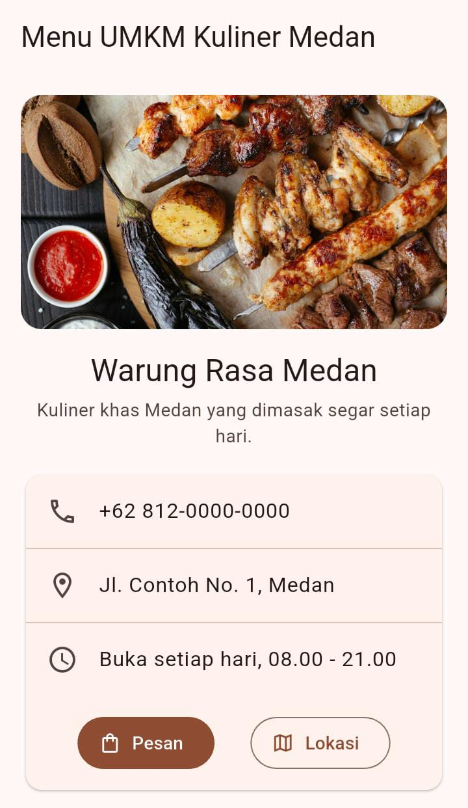
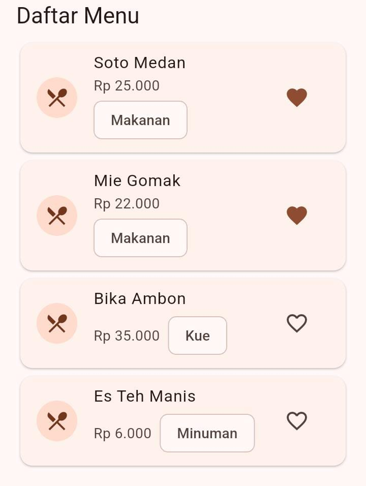
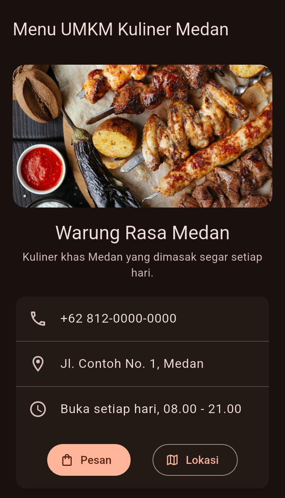
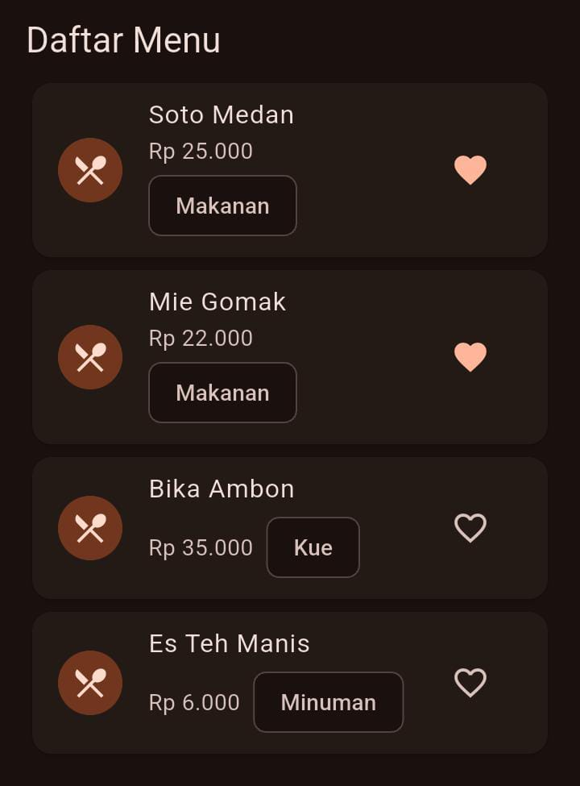

# Tugas Rutin 5: Halaman Menu UMKM Kuliner Medan

Mata kuliah Pemrograman Mobile, Pertemuan 5.

## a. Identitas
- Nama: Khodotun Hadawiyah. M
- NIM: 4242250002
- Kelas: PSIK 24D

## b. Tangkapan layar

Aplikasi dijalankan di perangkat fisik Infinix SMART 9 (Android 14).

### Mode terang
| Bagian atas | Daftar menu |
|---|---|
|  |  |

### Mode gelap
| Bagian atas | Daftar menu |
|---|---|
|  |  |

## c. Diagram widget tree


Versi teks:

```
MaterialApp (MenuUmkmApp)                  [Stateless]
└── Scaffold (HalamanMenu)                 [Stateless]
    ├── AppBar
    └── ListView
        ├── _KepalaUsaha                   [Stateless]
        │   ├── ClipRRect → Image.network
        │   ├── Text (nama usaha)
        │   └── Text (deskripsi)
        ├── _KartuKontak                   [Stateless]
        │   └── Card
        │       ├── ListTile x3 (telepon, alamat, jam buka)
        │       └── Row
        │           ├── FilledButton.icon
        │           └── OutlinedButton.icon
        ├── Text "Daftar Menu"
        └── KartuMenu x4                   [Stateless]
            └── Card
                └── ListTile
                    ├── CircleAvatar → Icon
                    ├── Text (nama)
                    ├── Wrap → Text (harga), Chip (kategori)
                    └── TombolFavorit      [STATEFUL]
                        └── IconButton → Icon (hati)
```

Keterangan:
- Stateless: MenuUmkmApp, HalamanMenu, _KepalaUsaha, _KartuKontak, KartuMenu.
- Stateful: hanya TombolFavorit, karena menyimpan data `_favorit` yang berubah saat ditekan.

## d. Penjelasan arsitektur

Widget tree adalah susunan widget yang saya tulis di dalam `build()`, berfungsi sebagai konfigurasi ringan dan immutable tentang apa yang ingin ditampilkan, dan dibuat ulang setiap `build()` dipanggil. Element tree adalah jembatan yang bertahan lama: ia menyimpan objek `State`, mencocokkan widget baru dengan yang lama, dan menjadi `BuildContext`. Render tree menghitung ukuran serta posisi (layout) lalu menggambar (paint) ke layar lewat engine. Saat ikon hati ditekan, `setState()` menandai element `TombolFavorit` sebagai kotor, `build()` dipanggil ulang, dan widget baru dibandingkan dengan yang lama berdasarkan tipe dan key. Karena cocok, element dan render object lama dipakai ulang dan hanya propertinya yang diperbarui, sehingga yang dibangun ulang hanya `TombolFavorit` pada kartu yang ditekan, bukan seluruh halaman. `MenuUmkmApp` dan `HalamanMenu` saya buat Stateless karena hanya menyusun tampilan tanpa data yang berubah. `_KepalaUsaha` dan `_KartuKontak` juga Stateless karena isinya tetap, yaitu gambar, nama usaha, dan kontak. `KartuMenu` Stateless karena tampilannya hanya bergantung pada parameter nama, harga, dan kategori dari luar. `TombolFavorit` saya buat Stateful karena menyimpan data `_favorit` yang berubah akibat interaksi pengguna dan harus disimpan di kelas `State`. Bagian Stateful sengaja dibuat sekecil mungkin agar pembangunan ulang tidak membebani halaman, dan widget yang tidak berubah memakai `const` supaya Flutter dapat melewatinya.

## e. Pernyataan penggunaan AI

Saya menggunakan Claude (Anthropic) sebagai asisten untuk memandu langkah pengerjaan dan pemecahan galat environment, membantu menyusun kode aplikasi dan widget test, membuat diagram widget tree, serta merapikan draf penjelasan arsitektur pada bagian d. Seluruh langkah dijalankan sendiri di laptop dan perangkat saya, dan saya telah membaca serta memahami isi kode dan penjelasannya.